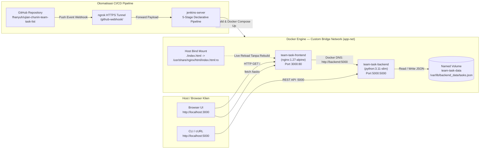

# Ujian Chunin Cloud Computing — Studi Kasus 6: Papan Catatan Tugas Kelompok (*Team Task & Note List*)

Repositori ini berisi implementasi aplikasi **Fullstack Berbasis Kontainer Docker** beserta **Otomatisasi Pipeline CI/CD Jenkins & GitHub Webhook** untuk memenuhi **Ujian Chunin (UTS) Cloud Computing** pada **Studi Kasus 6: Papan Catatan Tugas Kelompok (*Team Task & Note List*)**.

---

## Identitas Kelompok

| No | Nama Lengkap | NIM | Peran & Modul Tanggung Jawab |
| :-: | :--- | :---: | :--- |
| 1 | **Rafhan Mazaya Fathurrahman** | `101012300238` | Arsitektur `docker-compose.yml`, Custom Bridge Network `app-net`, & Komunikasi DNS Antar-Kontainer |
| 2 | **Zahra Talitha Putri** | `101012300192` | Backend Python REST API (`app.py`), `Dockerfile`, & Integrasi Asynchronous `fetch()` UI (`index.html`) |
| 3 | **Clara Novita Fitriani** | `101012330008` | Persistensi Named Volume (`team-task-data`), Pengujian Data Immunity (`docker rm -f`), & Live Bind Mount |
| 4 | **Rafif Riqullah Siregar** | `101012300320` | Otomatisasi `Jenkinsfile` (5 Stage Declarative Pipeline), GitHub PAT Credentials, & Webhook via `ngrok` |

---

## 1. Diagram & Spesifikasi Arsitektur Sistem




### Komponen Infrastruktur Utama
1. **Backend Service (`team-task-backend`)**:
   - Dibangun menggunakan `Dockerfile` berbasis `python:3.11-slim` (`app.py`).
   - Menyediakan endpoint REST API `/health`, `GET /tasks`, `POST /tasks`, `PATCH /tasks?index=X`, dan `DELETE /tasks?index=X` (serta alias `/messages`).
   - Menyimpan seluruh data tugas secara persisten di dalam berkas `/var/lib/backend_data/tasks.json` yang terhubung ke **Docker Named Volume `team-task-data`**.
2. **Frontend Service (`team-task-frontend`)**:
   - Menggunakan image `nginx:1.27-alpine` pada port `3000:80`.
   - Menggunakan **Bind Mount** dari berkas `./index.html` di host ke `/usr/share/nginx/html/index.html:ro` sehingga perubahan antarmuka langsung terlihat tanpa *rebuild* image.
   - Meneruskan request API ke kontainer backend menggunakan **Docker Internal DNS Service Name** (`http://backend:5000`) di dalam jaringan terisolasi **`app-net`**.
3. **CI/CD Pipeline (`Jenkinsfile`)**:
   - Terdiri dari 5 tahap deklaratif: **1. Checkout**, **2. Syntax Check**, **3. Build Image**, **4. Automated Deployment**, dan **5. Health Check**.
   - Terintegrasi dengan **GitHub Personal Access Token (PAT)** dan **GitHub Webhook** melalui tunnel `ngrok` sehingga setiap `git push origin main` memicu *build* dan *re-deploy* otomatis.

---

## 2. Struktur Direktori Proyek

```text
ujian-chunin/
├── app.py                                                # Layanan Backend REST API Python (ThreadingHTTPServer)
├── index.html                                            # Antarmuka Frontend Papan Catatan Tugas Kelompok
├── Dockerfile                                            # Definisi image kontainer team-task-backend
├── docker-compose.yml                                    # Orkestrasi layanan, Named Volume team-task-data, & jaringan app-net
├── Jenkinsfile                                           # Definisi 5-Stage Declarative Pipeline CI/CD Jenkins
├── .dockerignore                                         # Pengecualian berkas saat proses docker build
├── .gitignore                                            # Pengecualian berkas sementara Git
├── README.md                                             # Dokumentasi teknis repositori
├── Panduan_Tutorial_dan_Narasi_Video_Ujian_Chunin.pdf    # Dokumen panduan lengkap & naskah narasi video 4 pembicara
└── screenshots/                                          # Bukti tangkapan layar eksekusi end-to-end (1920x1080)
```

---

## 3. Cara Menjalankan Aplikasi Secara Lokal

```bash
# 1. Jalankan seluruh layanan (build image backend, buat volume team-task-data & network app-net)
docker compose up -d --build

# 2. Periksa status kontainer, jaringan, dan volume
docker compose ps
docker network inspect app-net
docker volume inspect team-task-data

# 3. Uji endpoint REST API Backend & Komunikasi DNS
curl -i http://localhost:5000/health
curl -s http://localhost:5000/tasks | python3 -m json.tool
docker exec team-task-frontend wget -qO- http://backend:5000/health
```

Akses antarmuka web melalui peramban pada alamat: **`http://localhost:3000`**.

---

## 4. Spesifikasi Endpoint REST API & Penanganan Error

| Method | Endpoint | Deskripsi | Kode Status Sukses | Kode Status Error |
| :---: | :--- | :--- | :---: | :---: |
| `GET` | `/health` | Memeriksa kesehatan layanan backend dan lokasi penyimpanan volume | `200 OK` | - |
| `GET` | `/tasks` | Mengambil seluruh daftar tugas beserta ringkasan beban kerja anggota | `200 OK` | - |
| `POST` | `/tasks` | Menambahkan tugas kelompok baru ke `/var/lib/backend_data/tasks.json` | `201 Created` | `400 Bad Request` (judul kosong / JSON tidak valid) |
| `PATCH` | `/tasks?index=X` | Memperbarui status atau atribut tugas pada indeks ke-`X` | `200 OK` | `400 Bad Request` / `404 Not Found` |
| `DELETE` | `/tasks?index=X` | Menghapus tugas secara real-time berdasarkan indeks ke-`X` | `200 OK` | `400 Bad Request` / `404 Not Found` (indeks di luar batas) |

---

## 5. Bukti Pengujian End-to-End

1. **Orkestrasi Docker Compose, Custom Bridge Network `app-net`, & Named Volume `team-task-data`**:
   
2. **Antarmuka Papan Catatan Tugas Kelompok (`http://localhost:3000`)**:
   
3. **Penambahan Tugas Baru (`POST /tasks` — `201 Created`) & Penghapusan Real-Time (`DELETE /tasks?index=X` — `200 OK`)**:
   
   
4. **Simulasi Data Immunity (`docker rm -f team-task-backend`)**:
   
5. **Simulasi Live Bind Mount (`index.html`) Tanpa Rebuild Image**:
   
6. **Otomatisasi Pipeline Jenkins CI/CD via GitHub Webhook**:
   
   
