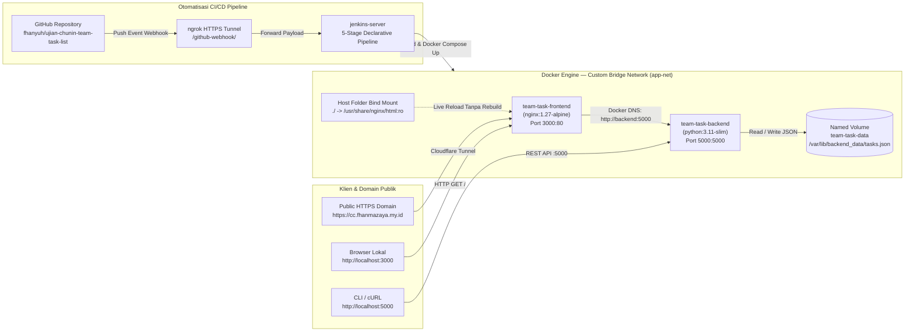

# Ujian Chunin Cloud Computing — Studi Kasus 6: Papan Catatan Tugas Kelompok (*Team Task & Note List*)

Repositori ini berisi implementasi aplikasi **Fullstack Berbasis Kontainer Docker** beserta **Otomatisasi Pipeline CI/CD Jenkins & GitHub Webhook** untuk memenuhi **Ujian Chunin (UTS) Cloud Computing** pada **Studi Kasus 6: Papan Catatan Tugas Kelompok (*Team Task & Note List*)**.

- **Akses Publik Web UI & API (Cloudflare Tunnel HTTPS)**: **[`https://cc.fhanmazaya.my.id`](https://cc.fhanmazaya.my.id)**
- **Health Check Endpoint Publik**: [`https://cc.fhanmazaya.my.id/health`](https://cc.fhanmazaya.my.id/health)
- **REST API Endpoint Publik**: [`https://cc.fhanmazaya.my.id/tasks`](https://cc.fhanmazaya.my.id/tasks)
- **Akses Lokal Frontend / Backend**: `http://localhost:3000` / `http://localhost:5000`

---

## Identitas Kelompok

| No | Nama Lengkap | NIM | Peran & Modul Tanggung Jawab |
| :-: | :--- | :---: | :--- |
| 1 | **Rafhan Mazaya Fathurrahman** | `101012300238` | Arsitektur `docker-compose.yml`, Custom Bridge Network `app-net`, Komunikasi DNS Antar-Kontainer, & Tunnel Domain `cc.fhanmazaya.my.id` |
| 2 | **Zahra Talitha Putri** | `101012300192` | Backend Python REST API (`app.py`), `Dockerfile`, & Integrasi Asynchronous `fetch()` UI (`index.html`) |
| 3 | **Clara Novita Fitriani** | `101012330008` | Persistensi Named Volume (`team-task-data`), Pengujian Data Immunity (`docker rm -f`), & Live Bind Mount |
| 4 | **Rafif Riqullah Siregar** | `101012300320` | Otomatisasi `Jenkinsfile` (5 Stage Declarative Pipeline), GitHub PAT Credentials, & Webhook via `ngrok` |

---

## 1. Diagram & Spesifikasi Arsitektur Sistem




### Komponen Infrastruktur Utama
1. **Backend Service (`team-task-backend`)**:
   - Dibangun menggunakan `Dockerfile` berbasis `python:3.11-slim` (`app.py`).
   - Menyediakan endpoint REST API `/health`, `GET /tasks`, `POST /tasks`, `PATCH /tasks?index=X`, dan `DELETE /tasks?index=X` (serta alias `/messages`).
   - Menyimpan seluruh data tugas secara persisten di dalam berkas `/var/lib/backend_data/tasks.json` yang terhubung ke **Docker Named Volume `team-task-data`**.
2. **Frontend Service (`team-task-frontend`)**:
   - Menggunakan image `nginx:1.27-alpine` pada port `3000:80` dan dapat diakses secara publik melalui **`https://cc.fhanmazaya.my.id`**.
   - Menggunakan **Bind Mount** ke direktori host lokal (`./:/usr/share/nginx/html:ro`) sehingga perubahan pada `index.html` langsung terlihat tanpa *rebuild* image.
   - Meneruskan request API ke kontainer backend menggunakan **Docker Internal DNS Service Name** (`http://backend:5000`) di dalam jaringan terisolasi **`app-net`**.
3. **CI/CD Pipeline (`Jenkinsfile`)**:
   - Terdiri dari 5 tahap deklaratif: **1. Checkout**, **2. Syntax Check**, **3. Build Image**, **4. Automated Deployment**, dan **5. Health Check**.
   - Terintegrasi dengan **GitHub Personal Access Token (PAT)** dan **GitHub Webhook** melalui tunnel `ngrok` sehingga setiap `git push origin main` memicu *build* dan *re-deploy* otomatis.

---

## 2. Struktur Direktori Proyek

```text
ujian-chunin/
├── app.py                                                # Layanan Backend REST API Python (ThreadingHTTPServer)
├── index.html                                            # Antarmuka Frontend Papan Catatan Tugas Kelompok
├── Dockerfile                                            # Definisi image kontainer team-task-backend
├── docker-compose.yml                                    # Orkestrasi layanan, Named Volume team-task-data, & jaringan app-net
├── Jenkinsfile                                           # Definisi 5-Stage Declarative Pipeline CI/CD Jenkins
├── .dockerignore                                         # Pengecualian berkas saat proses docker build
├── .gitignore                                            # Pengecualian berkas sementara Git
├── README.md                                             # Dokumentasi teknis repositori
├── Panduan_Tutorial_dan_Narasi_Video_Ujian_Chunin.pdf    # Dokumen panduan lengkap & naskah narasi video 4 pembicara
└── screenshots/                                          # Bukti tangkapan layar eksekusi end-to-end (1920x1080)
```

---

## 3. Langkah Instalasi & Menjalankan Aplikasi Secara Lokal

```bash
# 1. Clone repositori dan masuk ke direktori proyek
git clone https://github.com/fhanyuh/ujian-chunin-team-task-list.git
cd ujian-chunin-team-task-list

# 2. Jalankan seluruh layanan (build image backend, buat volume team-task-data & network app-net)
docker compose -p ujian-chunin up -d --build

# 3. Periksa status kontainer, jaringan app-net, dan volume team-task-data
docker compose -p ujian-chunin ps
docker network inspect app-net
docker volume inspect team-task-data

# 4. Uji endpoint REST API Backend & Komunikasi DNS
curl -i http://localhost:5000/health
curl -s https://cc.fhanmazaya.my.id/tasks | python3 -m json.tool
docker exec team-task-frontend wget -qO- http://backend:5000/health
```

Akses antarmuka web melalui peramban pada alamat publik **`https://cc.fhanmazaya.my.id`** atau alamat lokal **`http://localhost:3000`**.

---

## 4. Langkah Instalasi & Konfigurasi Jenkins CI/CD, GitHub PAT, & Webhook

### A. Menyiapkan Kontainer Server Jenkins & Docker CLI Plugin
Pastikan kontainer `jenkins-server` berjalan dengan akses ke socket Docker host (`/var/run/docker.sock`) dan plugin `docker-compose` tersedia di dalam kontainer:

```bash
# 1. Jalankan kontainer Jenkins (jika belum berjalan)
docker run -d --name jenkins-server \
  -p 8080:8080 -p 50000:50000 \
  -v jenkins-data:/var/jenkins_home \
  -v /var/run/docker.sock:/var/run/docker.sock \
  jenkins/jenkins:lts-jdk17

# 2. Pasang plugin Docker Compose CLI ke dalam kontainer jenkins-server
docker exec -u root jenkins-server mkdir -p /usr/local/lib/docker/cli-plugins
docker cp /usr/libexec/docker/cli-plugins/docker-compose jenkins-server:/usr/local/lib/docker/cli-plugins/docker-compose
docker exec -u root jenkins-server chmod +x /usr/local/lib/docker/cli-plugins/docker-compose
```

### B. Konfigurasi Kredensial GitHub Personal Access Token (PAT) di Jenkins
1. Buka dashboard Jenkins (`http://localhost:8080`) $\rightarrow$ **Manage Jenkins** $\rightarrow$ **Credentials** $\rightarrow$ **System** $\rightarrow$ **Global credentials (unrestricted)** $\rightarrow$ **Add Credentials**.
2. Pilih **Kind**: `Username with password`.
3. Isi **Username** dengan akun GitHub (`fhanyuh`), **Password** dengan GitHub Personal Access Token (PAT) yang memiliki izin `repo` dan `admin:repo_hook`, serta **ID**: `github-pat-readonly`.

### C. Membuat Pipeline Job `ujian-chunin-pipeline`
1. Klik **New Item** pada dashboard Jenkins, masukkan nama **`ujian-chunin-pipeline`**, pilih tipe **Pipeline**, lalu klik **OK**.
2. Pada bagian **Triggers**, centang **GitHub hook trigger for GITScm polling**.
3. Pada bagian **Pipeline**:
   - **Definition**: `Pipeline script from SCM`
   - **SCM**: `Git`
   - **Repository URL**: `https://github.com/fhanyuh/ujian-chunin-team-task-list.git`
   - **Credentials**: `github-pat-readonly`
   - **Branch Specifier**: `*/main`
   - **Script Path**: `Jenkinsfile`
4. Klik **Save** dan jalankan **Build Now** satu kali untuk menginisialisasi baseline repositori Git.

### D. Ekspos Port Jenkins dengan `ngrok` & Pendaftaran GitHub Webhook
```bash
# 1. Ekspos port 8080 Jenkins ke internet menggunakan ngrok
ngrok http 8080

# 2. Daftarkan URL publik ngrok (/github-webhook/) ke pengaturan Webhook repositori GitHub
gh api -X POST repos/fhanyuh/ujian-chunin-team-task-list/hooks \
  -f name="web" \
  -F active=true \
  -f "events[]=push" \
  -f "config[url]=https://unlocated-waylon-potently.ngrok-free.dev/github-webhook/" \
  -f "config[content_type]=json"
```
Setiap kali pengembang menjalankan `git push origin main`, GitHub mengirimkan event `push` ke `/github-webhook/` dan memicu kelima tahap pipeline secara otomatis.

---

## 5. Spesifikasi Endpoint REST API & Penanganan Error

| Method | Endpoint | Deskripsi | Kode Status Sukses | Kode Status Error |
| :---: | :--- | :--- | :---: | :---: |
| `GET` | `/health` | Memeriksa kesehatan layanan backend dan lokasi penyimpanan volume | `200 OK` | - |
| `GET` | `/tasks` | Mengambil seluruh daftar tugas beserta ringkasan beban kerja anggota | `200 OK` | - |
| `POST` | `/tasks` | Menambahkan tugas kelompok baru ke `/var/lib/backend_data/tasks.json` | `201 Created` | `400 Bad Request` (judul kosong / JSON tidak valid) |
| `PATCH` | `/tasks?index=X` | Memperbarui status atau atribut tugas pada indeks ke-`X` | `200 OK` | `400 Bad Request` / `404 Not Found` |
| `DELETE` | `/tasks?index=X` | Menghapus tugas secara real-time berdasarkan indeks ke-`X` | `200 OK` | `400 Bad Request` / `404 Not Found` (indeks di luar batas) |

---

## 6. Bukti Pengujian End-to-End

1. **Orkestrasi Docker Compose, Custom Bridge Network `app-net`, & Named Volume `team-task-data`**:
   
2. **Antarmuka Papan Catatan Tugas Kelompok (`https://cc.fhanmazaya.my.id`)**:
   
3. **Penambahan Tugas Baru (`POST /tasks` — `201 Created`) & Penghapusan Real-Time (`DELETE /tasks?index=X` — `200 OK`)**:
   
   
4. **Simulasi Data Immunity (`docker rm -f team-task-backend`)**:
   
5. **Simulasi Live Bind Mount (`index.html`) Tanpa Rebuild Image**:
   
6. **Otomatisasi Pipeline Jenkins CI/CD via GitHub Webhook**:
   
   
