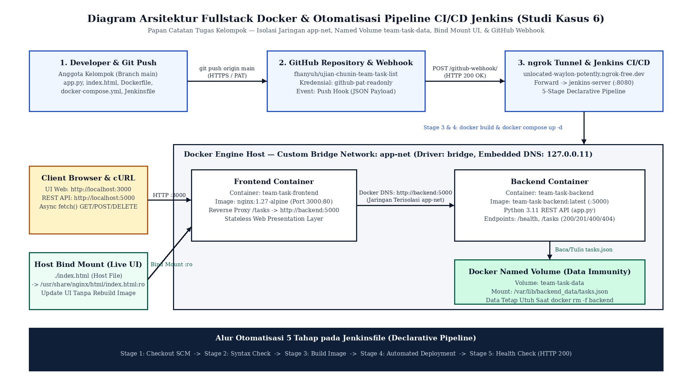
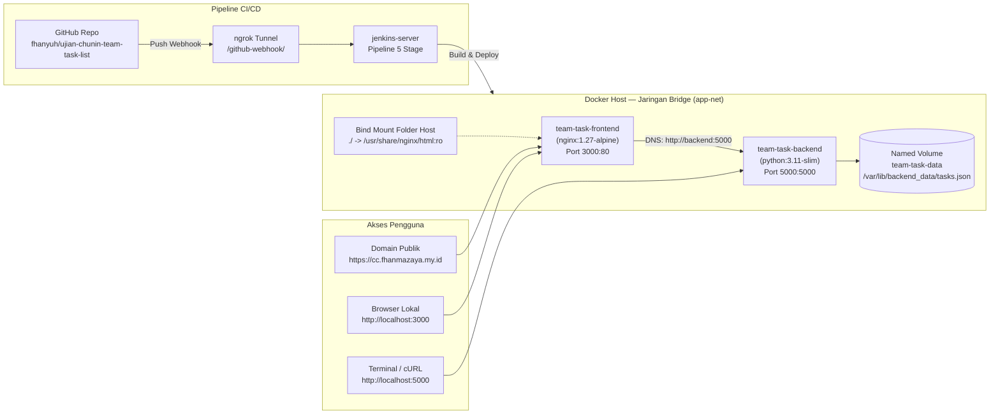
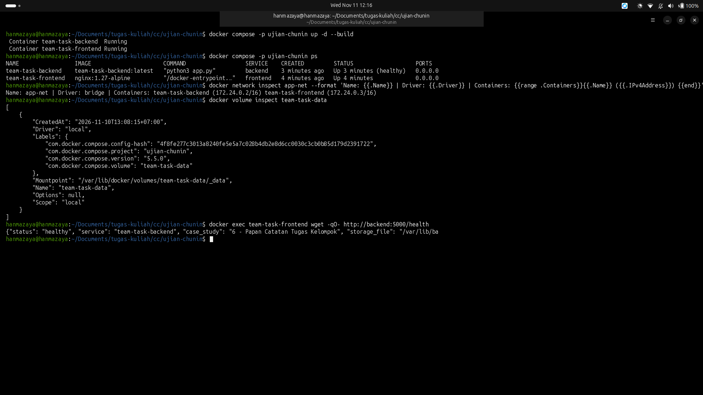
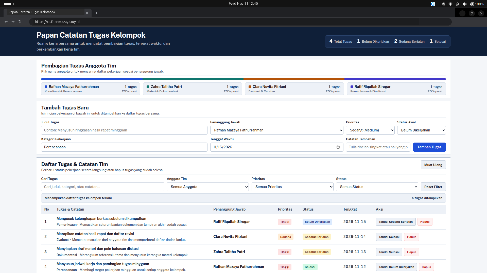
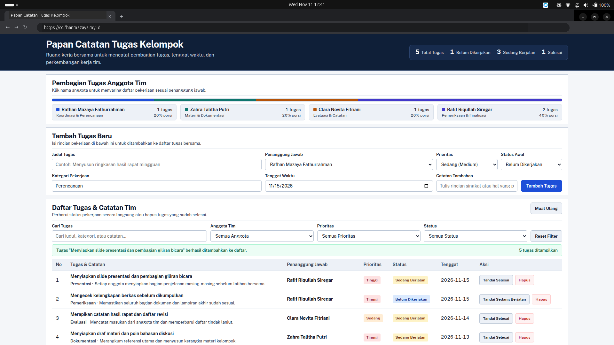
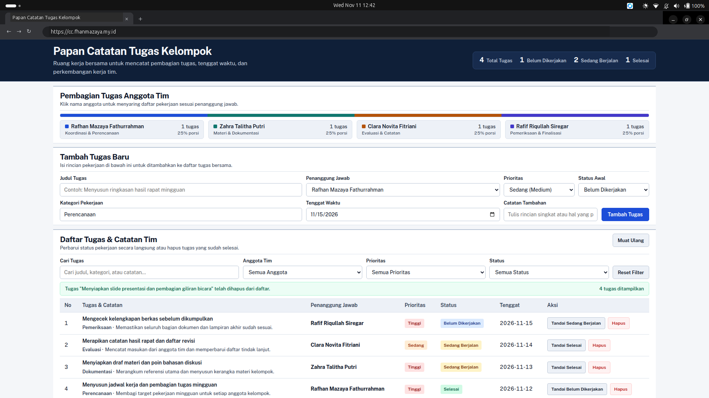
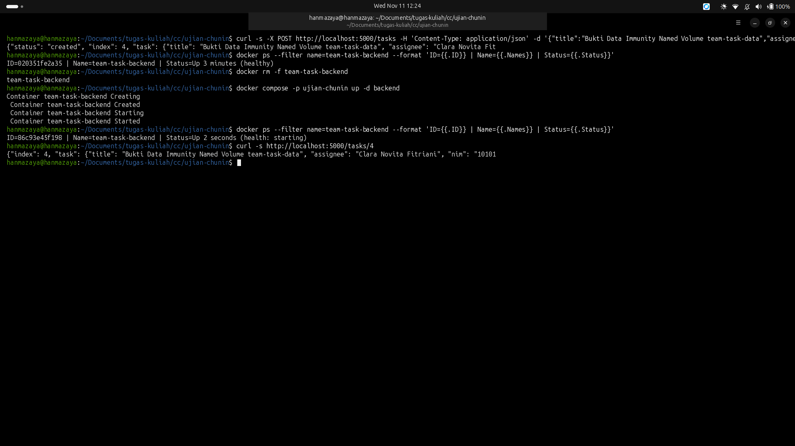
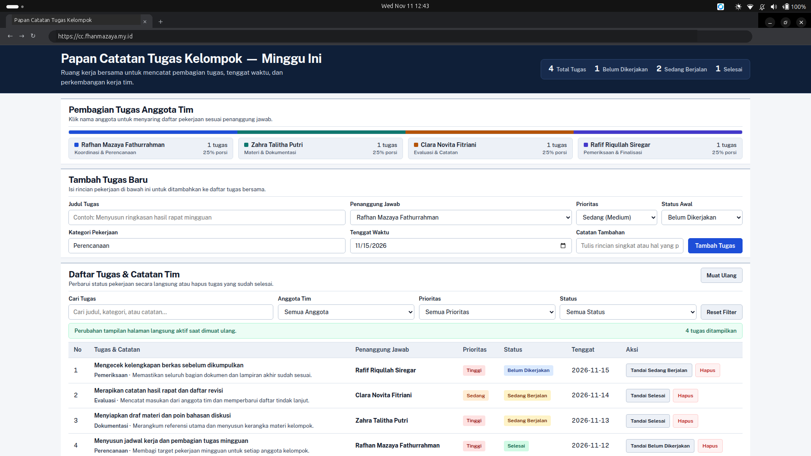
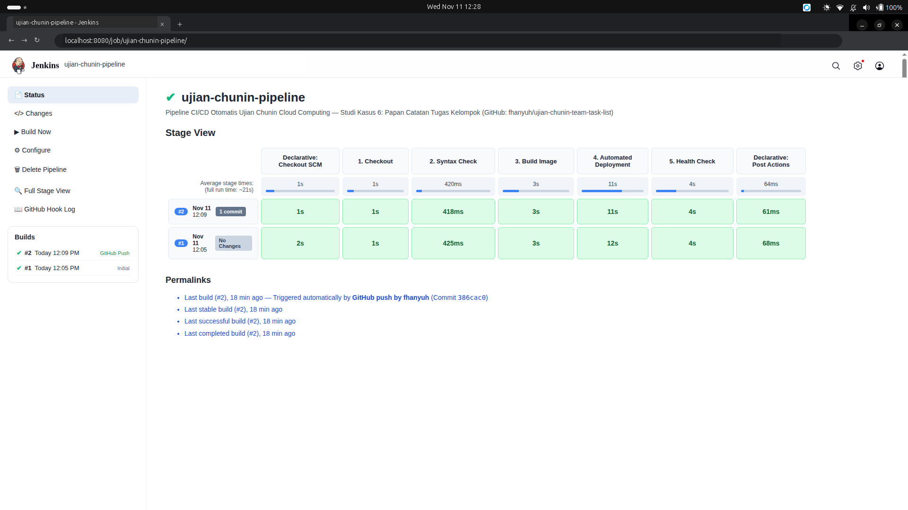
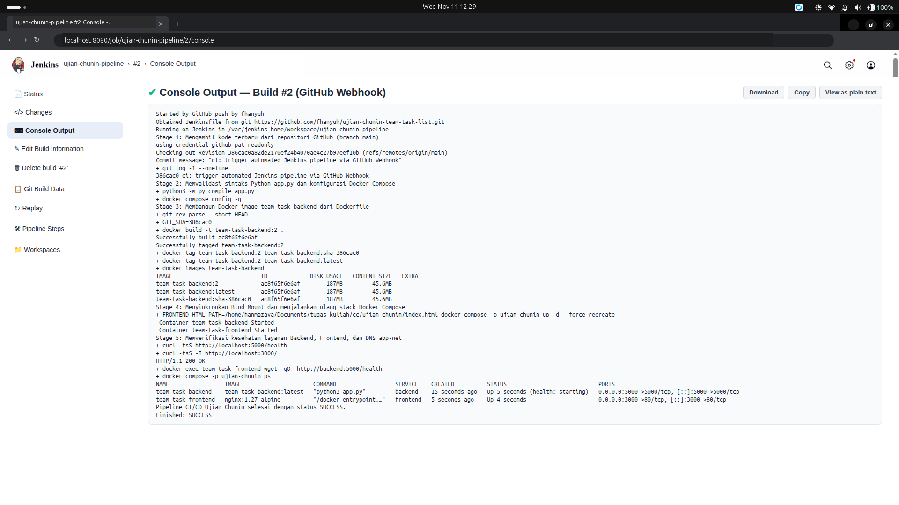

# Papan Catatan Tugas Kelompok — Ujian Chunin Cloud Computing (Studi Kasus 6)

Repositori ini berisi kode sumber aplikasi **Papan Catatan Tugas Kelompok (*Team Task & Note List*)** untuk tugas **Ujian Chunin (UTS) Cloud Computing**. Aplikasi ini dijalankan menggunakan dua kontainer Docker (Frontend Nginx & Backend Python) yang saling terhubung di jaringan internal `app-net`, serta dilengkapi pipeline CI/CD otomatis menggunakan Jenkins dan GitHub Webhook.

- **Web Aplikasi (Publik)**: **[`https://cc.fhanmazaya.my.id`](https://cc.fhanmazaya.my.id)**
- **Endpoint API Tasks**: [`https://cc.fhanmazaya.my.id/tasks`](https://cc.fhanmazaya.my.id/tasks)
- **Endpoint Health Check**: [`https://cc.fhanmazaya.my.id/health`](https://cc.fhanmazaya.my.id/health)
- **Akses Lokal**: `http://localhost:3000` (Frontend) & `http://localhost:5000` (Backend)

---

## Anggota Kelompok

| No | Nama Lengkap | NIM | Bagian yang Dikerjakan |
| :-: | :--- | :---: | :--- |
| 1 | **Rafhan Mazaya Fathurrahman** | `101012300238` | Konfigurasi `docker-compose.yml`, Custom Bridge Network `app-net`, DNS antar-kontainer, & domain `cc.fhanmazaya.my.id` |
| 2 | **Zahra Talitha Putri** | `101012300192` | Pembuatan Backend REST API (`app.py`), `Dockerfile`, & integrasi `fetch()` pada `index.html` |
| 3 | **Clara Novita Fitriani** | `101012330008` | Konfigurasi Named Volume (`team-task-data`), pengujian Data Immunity (`docker rm -f`), & Bind Mount UI |
| 4 | **Rafif Riqullah Siregar** | `101012300320` | Pembuatan `Jenkinsfile` (5 stage), pengaturan GitHub PAT di Jenkins, & pengujian Webhook via `ngrok` |

---

## 1. Gambaran Arsitektur Sistem





### Penjelasan Singkat Tiap Bagian
1. **Backend (`team-task-backend`)**:
   - Dibuat dengan Python 3.11 (`app.py`) dan dibungkus menggunakan `Dockerfile` (`python:3.11-slim`).
   - Menyediakan endpoint `/health`, `GET /tasks`, `POST /tasks`, `PATCH /tasks?index=X`, dan `DELETE /tasks?index=X`.
   - Data tugas disimpan ke file `/var/lib/backend_data/tasks.json` yang terhubung ke **Named Volume `team-task-data`**, sehingga data tidak hilang walaupun kontainer backend dihapus.
2. **Frontend (`team-task-frontend`)**:
   - Menggunakan image `nginx:1.27-alpine` di port `3000:80` dan dihubungkan ke domain `https://cc.fhanmazaya.my.id`.
   - Folder proyek di host dipasang menggunakan **Bind Mount** ke `/usr/share/nginx/html:ro`, jadi kalau file `index.html` diubah di host, tampilannya langsung berubah saat browser di-refresh tanpa perlu build ulang image.
   - Komunikasi dari Nginx ke backend memakai nama service Docker (`http://backend:5000`) lewat jaringan bridge `app-net`.
3. **Jenkins CI/CD (`Jenkinsfile`)**:
   - Berisi 5 stage: **1. Checkout**, **2. Syntax Check**, **3. Build Image**, **4. Automated Deployment**, dan **5. Health Check**.
   - Terhubung ke GitHub melalui Webhook dan `ngrok`, sehingga setiap ada `git push origin main`, Jenkins langsung menjalankan build dan memperbarui kontainer secara otomatis.

---

## 2. Susunan File di Repositori

```text
ujian-chunin/
├── app.py                                                # Kode Backend REST API Python (port 5000)
├── index.html                                            # Halaman web Papan Catatan Tugas Kelompok
├── Dockerfile                                            # Konfigurasi image untuk kontainer backend
├── docker-compose.yml                                    # Konfigurasi kontainer, volume team-task-data, & network app-net
├── Jenkinsfile                                           # Script pipeline otomatis 5 stage untuk Jenkins
├── PRODUCT.md                                            # Dokumen spesifikasi produk antarmuka
├── .dockerignore                                         # Daftar file yang diabaikan saat docker build
├── .gitignore                                            # Daftar file sementara yang diabaikan Git
├── README.md                                             # Dokumentasi proyek
├── Panduan_Tutorial_dan_Narasi_Video_Ujian_Chunin.pdf    # Panduan langkah kerja & naskah presentasi video kelompok
└── screenshots/                                          # Screenshot hasil pengujian aplikasi & pipeline
```

---

## 3. Cara Menjalankan di Komputer Lokal

```bash
# 1. Clone repositori dan masuk ke foldernya
git clone https://github.com/fhanyuh/ujian-chunin-team-task-list.git
cd ujian-chunin-team-task-list

# 2. Jalankan kontainer dengan Docker Compose
docker compose -p ujian-chunin up -d --build

# 3. Cek status kontainer, network app-net, dan volume team-task-data
docker compose -p ujian-chunin ps
docker network inspect app-net
docker volume inspect team-task-data

# 4. Tes endpoint API dan koneksi DNS dari frontend ke backend
curl -i http://localhost:5000/health
curl -s http://localhost:5000/tasks | python3 -m json.tool
docker exec team-task-frontend wget -qO- http://backend:5000/health
```

Setelah kontainer berjalan, buka web di **`http://localhost:3000`** atau lewat domain **`https://cc.fhanmazaya.my.id`**.

---

## 4. Langkah Instalasi & Pengaturan Jenkins CI/CD

### A. Menjalankan Kontainer Jenkins
Jika kontainer `jenkins-server` belum ada, jalankan perintah berikut agar Jenkins bisa mengakses Docker di host:

```bash
# 1. Jalankan kontainer Jenkins
docker run -d --name jenkins-server \
  -p 8080:8080 -p 50000:50000 \
  -v jenkins-data:/var/jenkins_home \
  -v /var/run/docker.sock:/var/run/docker.sock \
  jenkins/jenkins:lts-jdk17

# 2. Salin plugin docker-compose ke dalam kontainer Jenkins
docker exec -u root jenkins-server mkdir -p /usr/local/lib/docker/cli-plugins
docker cp /usr/libexec/docker/cli-plugins/docker-compose jenkins-server:/usr/local/lib/docker/cli-plugins/docker-compose
docker exec -u root jenkins-server chmod +x /usr/local/lib/docker/cli-plugins/docker-compose
```

### B. Menambahkan Kredensial GitHub PAT di Jenkins
1. Buka `http://localhost:8080` $\rightarrow$ masuk ke **Manage Jenkins** $\rightarrow$ **Credentials** $\rightarrow$ **System** $\rightarrow$ **Global credentials (unrestricted)** $\rightarrow$ **Add Credentials**.
2. Pilih **Kind**: `Username with password`.
3. Isi **Username** dengan username GitHub (`fhanyuh`), **Password** dengan Personal Access Token (PAT) dari GitHub, dan **ID** diisi `github-pat-readonly`.

### C. Membuat Job Pipeline `ujian-chunin-pipeline`
1. Klik **New Item** di halaman utama Jenkins, beri nama **`ujian-chunin-pipeline`**, pilih **Pipeline**, lalu klik **OK**.
2. Di bagian **Triggers**, centang **GitHub hook trigger for GITScm polling**.
3. Di bagian **Pipeline**:
   - **Definition**: `Pipeline script from SCM`
   - **SCM**: `Git`
   - **Repository URL**: `https://github.com/fhanyuh/ujian-chunin-team-task-list.git`
   - **Credentials**: `github-pat-readonly`
   - **Branch Specifier**: `*/main`
   - **Script Path**: `Jenkinsfile`
4. Klik **Save**, lalu klik **Build Now** sekali untuk pancingan awal Git di Jenkins.

### D. Menghubungkan Webhook GitHub dengan `ngrok`
```bash
# 1. Jalankan ngrok untuk membuka akses ke port 8080 Jenkins
ngrok http 8080

# 2. Pasang URL ngrok (/github-webhook/) ke menu Webhooks di repositori GitHub
gh api -X POST repos/fhanyuh/ujian-chunin-team-task-list/hooks \
  -f name="web" \
  -F active=true \
  -f "events[]=push" \
  -f "config[url]=https://unlocated-waylon-potently.ngrok-free.dev/github-webhook/" \
  -f "config[content_type]=json"
```

---

## 5. Daftar Endpoint API Backend

| Method | Endpoint | Fungsi | Status Sukses | Status Error |
| :---: | :--- | :--- | :---: | :---: |
| `GET` | `/health` | Mengecek apakah service backend aktif | `200 OK` | - |
| `GET` | `/tasks` | Mengambil semua daftar tugas dan ringkasan progres | `200 OK` | - |
| `POST` | `/tasks` | Menambah tugas baru ke `tasks.json` | `201 Created` | `400 Bad Request` (jika judul kosong) |
| `PATCH` | `/tasks?index=X` | Mengubah status/isi tugas pada index ke-`X` | `200 OK` | `400` / `404 Not Found` |
| `DELETE` | `/tasks?index=X` | Menghapus tugas pada index ke-`X` | `200 OK` | `400` / `404 Not Found` (jika index tidak ada) |

---

## 6. Dokumentasi Hasil Pengujian

1. **Menjalankan Docker Compose, Jaringan `app-net`, & Volume `team-task-data`**:
   
2. **Tampilan Web Papan Catatan Tugas Kelompok (`https://cc.fhanmazaya.my.id`)**:
   
3. **Menambah Tugas Baru & Menghapus Tugas dari Daftar**:
   
   
4. **Pengujian Data Immunity (`docker rm -f team-task-backend`)**:
   
5. **Pengujian Live Bind Mount (`index.html`) Tanpa Rebuild Image**:
   
6. **Hasil Build Otomatis Jenkins dari GitHub Webhook**:
   
   
